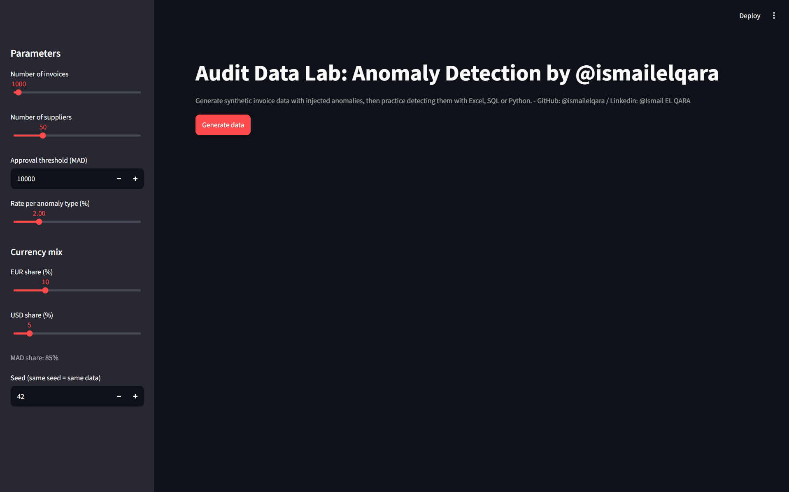

# Audit Data Lab by @Ismail EL QARA

Generate realistic **synthetic invoice data** with **injected, labeled anomalies**
to practice audit data analytics (Excel, SQL, Python) without touching real data.

**[Live demo](<https://audit-data-lab-jgjbarpdruohwp47yuo56p.streamlit.app/>)** Built by [Ismail EL QARA](<https://www.linkedin.com/in/ismailelqara/>)



## Why this project?
Auditors and Auditing students rarely get a dataset where the answers are known. This tool produces two files:

| File | Purpose |
|---|---|
| `invoices.csv` | The data you audit (no hints inside) |
| `answer_key.csv` | The ground truth, used only to score your tests |

You run your tests on the data, then compare with the key to compute
**precision** and **recall**.

## Quick start
```bash
git clone (https://github.com/ismailelqara/audit-data-lab)
cd data-generator
pip install -r requirements.txt
streamlit run app.py
```
Or generate files directly: `python generator.py`

## Anomalies injected

| Type | What it simulates | How to detect it |
|---|---|---|
| Below_Threshold | Amounts just under the approval limit | Filter `Amount_MAD` in [97% of limit, limit) |
| Round_Amount | Suspiciously round amounts | `MOD(Amount, 1000) = 0` |
| Weekend | Invoices dated Saturday/Sunday | `WEEKDAY(date, 2) > 5` |
| No_PO | Invoice without a purchase order | `PO_Number` is empty |
| Split | One purchase split in two to avoid approval | Same supplier + same day, each under the limit, sum above it |
| Duplicate | Same invoice entered twice | Same supplier + amount + currency within a few days |

## Suggested workflow
1. Generate a dataset (choose size, threshold, anomaly rate, currency mix, seed).
2. Audit it using only `invoices.csv`.
3. Open `answer_key.csv` **last** and measure how many anomalies you caught.
4. Also test Benford's Law on `Amount_MAD`.

## Parameters
Number of invoices, number of suppliers, approval threshold (MAD),
anomaly rate, EUR/USD share, and a seed (same seed = same dataset).

## Project structure
`generator.py` (data engine) · `app.py` (Streamlit UI) · `tests/` (pytest)

## Limitations
- FX rates are fixed and illustrative.
- Synthetic data only; no ghost vendors or seasonality yet.
- The generator uses module-level state, so it is meant for single-user use.

## Roadmap
- [ ] Ghost vendors and approver-concentration anomalies
- [ ] Monthly seasonality
- [ ] Built-in analysis tab (upload a file and run the tests)

## License
MIT